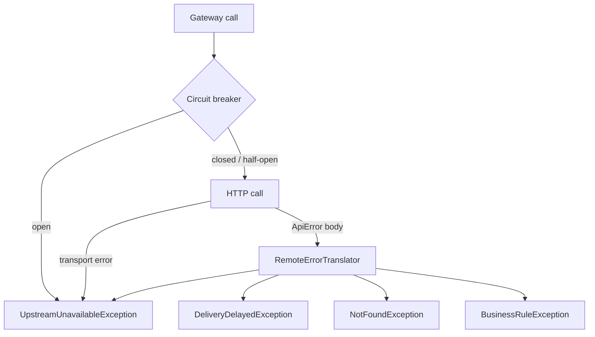
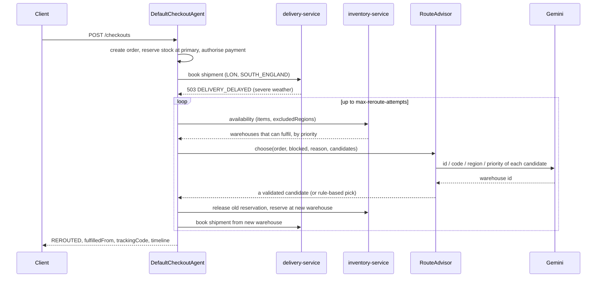

# Architecture

## Architecture Decisions

| # | Decision | Reason | Consequence |
|---|---|---|---|
| 1 | Separate Spring Boot apps in one Maven monorepo | Independent ownership and deployment, but one build and one place to run tests | Shared code must be disciplined; it lives only in `commerce-common` |
| 2 | Database per service (H2) | No shared schema, so services can change independently | No cross-service transactions; the agent compensates explicitly |
| 3 | REST between services, with the agent as the only caller | Simple to run locally and to test offline | The agent is a single orchestration point, not a choreography of events |
| 4 | Shared `commerce-common` jar for contracts, errors, paging, cache, OpenAPI | One definition of each DTO and error code; "do not hard code, reuse" | Services are coupled to the contract version; contracts are records and change additively |
| 5 | Orchestration in an agent, not in the delivery service | Delivery stays a simple booking service; recovery policy lives in one place | The agent must handle partial failure (see compensation below) |
| 6 | Gemini only ranks candidates that code has already validated | The model cannot invent a warehouse, ignore stock or pick a blocked region | Worst case is a sub-optimal valid choice, never an invalid one |
| 7 | Rule-based fallback when Gemini is off, fails or answers badly | Checkout must not depend on an LLM being available | Behaviour is deterministic and testable offline |
| 8 | Resilience4j circuit breaker per downstream service | Stop hammering a failing service and fail fast | Breaker state is per agent instance |
| 9 | Caffeine in-process cache | No extra infrastructure; bounded by TTL and size | Cache is per instance, so entries can be stale across instances until TTL expires |
| 10 | Uniform `ApiError` with stable `ErrorCode` | Clients and the agent can branch on a code, not on message text | New failure modes need a new code |
| 11 | All configuration through `${ENV_VAR:default}` in `application.yml` | Same artifact runs locally and on Cloud Run | See [DEPLOYMENT.md](DEPLOYMENT.md#environment-variables) |

### Delivery delay is a business outcome, not a crash

`delivery-service` answers a blocked booking with `503 DELIVERY_DELAYED`. The agent maps that code back to `DeliveryDelayedException` and treats it as a signal to re-route. It is configured as a recorded failure on the delivery circuit breaker, but the agent also reacts to it directly, so a delay never surfaces as an error to the customer.

### Errors and the circuit breaker

| Exception | Counted as breaker failure | Agent behaviour |
|---|---|---|
| `UpstreamUnavailableException` | Yes | Stops re-routing; delivery outcome is `DELIVERY_DELAYED` |
| `DeliveryDelayedException` | Yes | Re-route to another warehouse |
| `BusinessRuleException` | No (ignored) | Treated as a stock race during re-routing; try the next candidate |
| `NotFoundException` | No (ignored) | Tolerated when releasing a reservation that does not exist |

Breaker settings are in `rerouting-agent/src/main/resources/application.yml`: a default config (window 10, minimum 5 calls, 50% failure, 30 s open) and a stricter `delivery` config (window 6, minimum 3, 60 s open). Delivery uses one breaker per origin region (`delivery-service-<REGION>`), so a weather-blocked region opens its own breaker without affecting shipments from other regions. When that breaker is open the agent receives `DeliveryDelayedException` without calling delivery-service and re-routes immediately. Customer notification is best-effort and never fails a checkout.

### Compensation instead of distributed transactions

The checkout is a saga-style sequence, with each step undone explicitly if a later one fails:

| Failure | Compensation |
|---|---|
| No warehouse has stock | Order cancelled |
| Payment declined | Reservation released, order cancelled |
| Re-route target cannot reserve stock | Original reservation restored, next candidate tried |
| No warehouse can ship | Order stays `DELIVERY_DELAYED` and is accepted (`202`) |

Payments are idempotent per order id, and shipments are idempotent per order and warehouse, so a retry does not double-charge or double-book.

## Design Patterns

| Pattern / principle | Where |
|---|---|
| Strategy | `RouteAdvisor` with `GeminiRouteAdvisor` and `PriorityRouteAdvisor`; `PaymentProcessor` with `SimulatedPaymentProcessor`; `WeatherService` with `InMemoryWeatherService` |
| Decorator-style fallback | `GeminiRouteAdvisor` wraps a fallback `RouteAdvisor` |
| Gateway / Adapter | `OrderGateway`, `InventoryGateway`, `PaymentGateway`, `CrmGateway`, `DeliveryGateway` with `Http*Gateway` implementations |
| Template method (shared base) | `RemoteGateway` provides the client and circuit-breaker plumbing for every gateway |
| Circuit Breaker | `CircuitBreakerExecutor` over Resilience4j |
| Saga (orchestrated) | `DefaultCheckoutAgent` and `ShipmentCoordinator` |
| Repository | Spring Data repositories per service |
| Factory | `RestClientFactory`, `PageRequestFactory` |
| DTO / value object | Java records in `*Contracts` interfaces |
| Facade | `CheckoutAgent` hides five services behind one call |
| Enum-based templates | `NotificationTemplate` holds all customer wording |
| State machine | `OrderStatusTransitions` |

### SOLID

- **Single responsibility:** controllers handle HTTP only; services hold rules; mappers convert; `ShipmentCoordinator` handles shipping and re-routing, `DefaultCheckoutAgent` handles the purchase flow, `CustomerNotifier` handles notification.
- **Open/closed:** a new routing strategy (for example, cost-based) is a new `RouteAdvisor` bean; no workflow code changes.
- **Liskov:** every `RouteAdvisor` returns one of the candidates it was given; `GeminiRouteAdvisor` guarantees this by validating the model's answer.
- **Interface segregation:** small interfaces (`AvailabilityService`, `ReservationService`, `StockService` rather than one inventory interface).
- **Dependency inversion:** the workflow depends on gateway and `RouteAdvisor` interfaces, so tests replace them with mocks and no HTTP is needed.

### Java 17 features used

Records for all DTOs and configuration properties, compact record constructors for defensive copies, switch expressions (`OrderStatusTransitions`, `RemoteErrorTranslator`), `var`, text blocks (the Gemini prompt) and `String.formatted`.

### Reuse (no hard-coding)

Ports, URLs, timeouts, credentials, thresholds, page sizes, cache TTL, seed warehouses, weather regions and Gemini model are all configuration. Pagination bounds, error handling, cache setup and OpenAPI metadata are defined once in `commerce-common` and auto-registered in every service.

## AI Flow

The agent uses Gemini for one decision only: which warehouse should take over.

### Step by step

1. `ShipmentCoordinator.ship` books from the primary warehouse. On `DeliveryDelayedException` it starts re-routing.
2. It adds the blocked warehouse's region to `excludedRegions` and asks inventory for warehouses that can fulfil every line. The result is already filtered by stock and ordered by priority.
3. `RouteAdvisor.choose` picks one candidate. With Gemini enabled this is `GeminiRouteAdvisor`; otherwise `PriorityRouteAdvisor` (lowest `priority`, then lowest id).
4. The reservation follows the chosen warehouse (release, then reserve; restored on failure).
5. The shipment is booked. If that warehouse is also blocked, its region is excluded and the loop repeats, up to `AGENT_MAX_REROUTE_ATTEMPTS` (default 3).
6. The customer is notified through CRM and the order moves to `REROUTED`, then `SHIPPED`.

### How the model is used and constrained

The LangChain4j `RoutingAssistant` is an AI service interface with a system message and a templated user message:

- The model is told to reply with the numeric warehouse id only.
- The model sees only each candidate's id, code, region and priority, plus the blocked region and the reason. It does not see customer identity or payment data.
- The delivery address is passed as `{{destination}}` and labelled in the prompt as untrusted text to be treated as data only. It cannot add candidates, because candidates come from inventory, not from the prompt.
- Temperature defaults to 0 (`GEMINI_TEMPERATURE`) for repeatable choices.

### Guardrails and fallback

`GeminiRouteAdvisor.parse` extracts numbers from the answer and keeps the first one that matches a candidate id. The result is therefore always a warehouse that is in stock and not in a blocked region.

| Situation | Result |
|---|---|
| Valid id from Gemini | Gemini's choice is used (`Agent (gemini) selected ...` in the timeline) |
| Answer matches no candidate or is empty | Logged, rule-based advisor decides |
| Gemini throws (network, quota, auth) | Logged, rule-based advisor decides |
| `GEMINI_ENABLED=false` (default) | Rule-based advisor only; no Vertex AI call is made |

The timeline names the advisor that made each decision, so a re-route is always auditable.

### Limits to be aware of

- `parse` picks the first matching number in free text. An answer that mentions several ids will use the first valid one, which is acceptable because every candidate is valid.
- Gemini ranks only; it does not decide whether to re-route, move money or change order state. Those steps are plain code.
- Model output is not persisted beyond the checkout `timeline` and logs.
