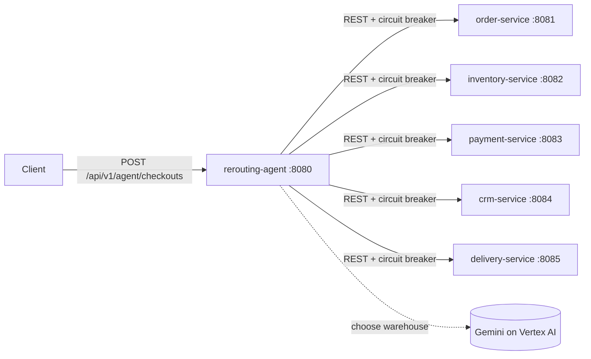

# Autonomous Commerce Platform

Six Spring Boot microservices plus an autonomous **re-routing agent**. When a delivery cannot leave a warehouse because of severe weather, the agent does not fail the order or page a human. It finds another warehouse that has stock, moves the stock reservation, books the shipment from there and tells the customer.

- Java 17, Spring Boot 3.3, Maven multi-module
- LangChain4j + Gemini (Vertex AI on GCP) for warehouse selection, with a deterministic fallback
- Resilience4j circuit breakers, Caffeine caching, pagination, H2 persistence
- OpenAPI / Swagger UI on every service

| Document | Content |
|---|---|
| [ARCHITECTURE.md](ARCHITECTURE.md) | Decisions, design patterns, AI flow |
| [API_REFERENCE.md](API_REFERENCE.md) | Every endpoint with request and response examples |
| [TESTING.md](TESTING.md) | Unit, integration and AI testing |
| [DEPLOYMENT.md](DEPLOYMENT.md) | Cloud Build, Cloud Run, environment variables |

## Architecture



| Module | Port | Responsibility |
|---|---|---|
| `commerce-common` | n/a | Shared contracts, error model, pagination, cache and OpenAPI configuration |
| `order-service` | 8081 | Order lifecycle with validated status transitions |
| `inventory-service` | 8082 | Warehouses, stock, cached availability search, reservations |
| `payment-service` | 8083 | Idempotent payment authorisation (simulated provider) |
| `crm-service` | 8084 | Customers and notification activity log |
| `delivery-service` | 8085 | Shipment booking, weather restrictions |
| `rerouting-agent` | 8080 | Checkout orchestration and autonomous re-routing |

Each service owns its own H2 database. Services only talk through REST, and the agent is the only caller.

## Setup

Prerequisites: JDK 17 or newer (the build targets release 17) and Maven 3.9+.

```powershell
mvn clean install
```

This builds every module and runs all unit tests.

## Local Run Instructions

Start each service in its own terminal, from the repository root:

```powershell
mvn -pl order-service spring-boot:run
mvn -pl inventory-service spring-boot:run
mvn -pl payment-service spring-boot:run
mvn -pl crm-service spring-boot:run
mvn -pl delivery-service spring-boot:run
mvn -pl rerouting-agent spring-boot:run
```

Defaults need no configuration: ports are 8080-8085, databases are in-memory H2, and Gemini is off, so the agent uses its rule-based advisor.

Swagger UI (with example requests and responses for every endpoint) and the raw OpenAPI spec are available on every service:

| Service | Swagger UI | OpenAPI JSON |
|---|---|---|
| Agent | http://localhost:8080/swagger-ui.html | http://localhost:8080/v3/api-docs |
| Orders | http://localhost:8081/swagger-ui.html | http://localhost:8081/v3/api-docs |
| Inventory | http://localhost:8082/swagger-ui.html | http://localhost:8082/v3/api-docs |
| Payments | http://localhost:8083/swagger-ui.html | http://localhost:8083/v3/api-docs |
| CRM | http://localhost:8084/swagger-ui.html | http://localhost:8084/v3/api-docs |
| Delivery | http://localhost:8085/swagger-ui.html | http://localhost:8085/v3/api-docs |

Health is at `/actuator/health`; the agent also exposes `/actuator/circuitbreakers`.

### Try the weather scenario

1. Register a customer (CRM):

   ```powershell
   curl -X POST http://localhost:8084/api/v1/crm/customers -H "Content-Type: application/json" `
     -d '{"name":"Asha Rao","email":"asha@example.com"}'
   ```

2. Simulate severe weather in the south of England (the seed data's primary warehouse, `LON`):

   ```powershell
   curl -X PUT http://localhost:8085/api/v1/delivery/weather -H "Content-Type: application/json" `
     -d '{"severe":true,"affectedRegions":["SOUTH_ENGLAND"]}'
   ```

3. Place an order through the agent:

   ```powershell
   curl -X POST http://localhost:8080/api/v1/agent/checkouts -H "Content-Type: application/json" `
     -d '{"customerId":1,"destination":"12 High St, Leeds","paymentMethod":"CARD","items":[{"sku":"SKU-100","quantity":2,"unitPrice":19.99}]}'
   ```

The response has `outcome: REROUTED`, fulfilled from `MAN`, with a `timeline` of every step the agent took. See [API_REFERENCE.md](API_REFERENCE.md) for the full payload.

To use Gemini instead of the rule-based advisor, set `GEMINI_ENABLED=true`, `GCP_PROJECT_ID` and authenticate with `gcloud auth application-default login`. See [DEPLOYMENT.md](DEPLOYMENT.md#environment-variables).

## Deployment

Each module is an independently deployable Spring Boot jar, intended for Cloud Run, built with Cloud Build, with Gemini on Vertex AI. See [DEPLOYMENT.md](DEPLOYMENT.md) for the build, deploy and configuration steps and the production caveats (in-memory H2, no inter-service authentication).

## API Guide

| Service | Base path | Main operations |
|---|---|---|
| Agent | `/api/v1/agent` | `POST /checkouts` |
| Orders | `/api/v1/orders` | create, get, list (paged), `PATCH /{id}/status` |
| Inventory | `/api/v1/inventory` | warehouses (paged), `POST /availability`, `PUT /warehouses/{id}/stock`, reserve and release |
| Payments | `/api/v1/payments` | pay (idempotent per order), get, list (paged) |
| CRM | `/api/v1/crm` | customers, notifications, customer activities (paged) |
| Delivery | `/api/v1` | `POST /shipments`, get, list (paged), `GET/PUT /delivery/weather` |

Conventions shared by all services:

- **Pagination:** `?page=0&size=20`. Page is zero-based; size defaults to 20 and is capped at 100 (`PAGE_DEFAULT_SIZE`, `PAGE_MAX_SIZE`).
- **Errors:** every failure returns the same `ApiError` body with a stable `code`. See [API_REFERENCE.md](API_REFERENCE.md#error-format).
- **Agent status codes:** `201` completed or re-routed, `202` delivery delayed with no alternative, `402` payment declined, `409` out of stock.

## Project layout

```
commerce-common/      shared contracts, errors, paging, cache, OpenAPI
order-service/        domain / service / web per service
inventory-service/
payment-service/
crm-service/
delivery-service/
rerouting-agent/      api, client (gateways), routing (AI), workflow, config
```

## Known limitations

- The services have no authentication. `PUT /api/v1/delivery/weather` and the other write endpoints are open; add authentication before exposing them publicly.
- H2 is in-memory by default, so data is lost on restart and is not shared between instances.
- Payment is simulated: amounts above `PAYMENT_MAX_AMOUNT` (default 10000) are declined.
- Weather is a simulated, in-memory switch, not a real weather feed.
